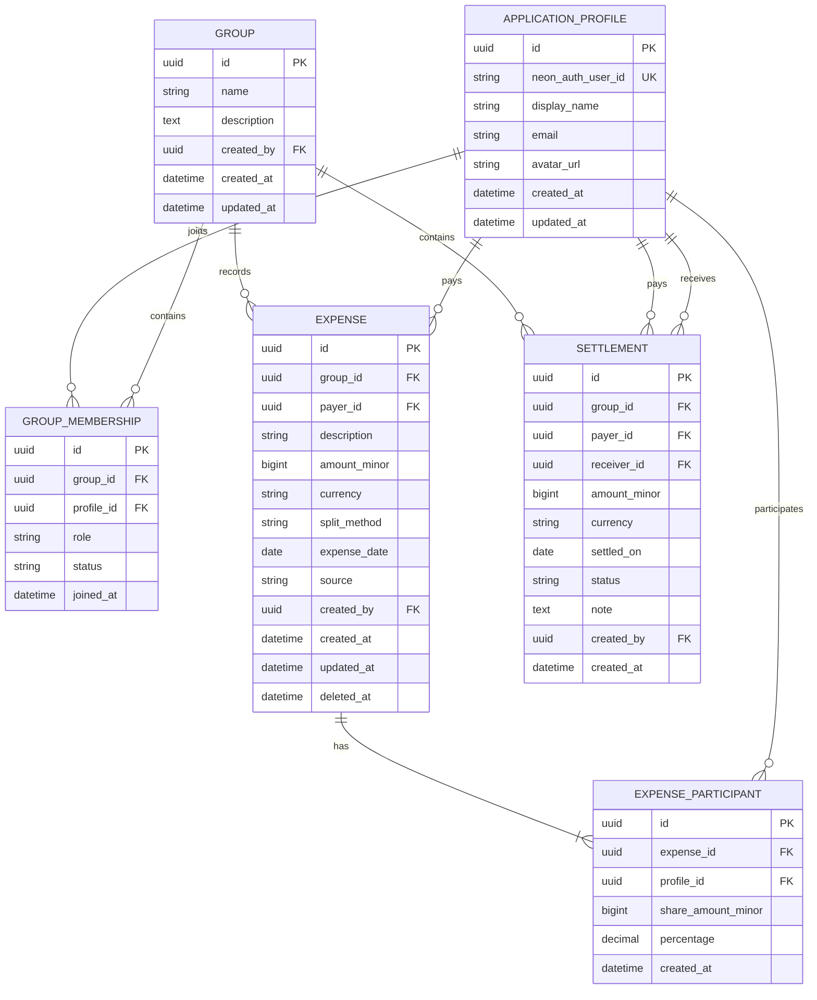

# Splitter AI — Database Models

**Status:** Implemented MVP schema and domain reference
**Database:** Neon PostgreSQL (Lakebase Postgres)  
**ORM:** Django ORM  
**Scope:** Internship MVP

> The MVP application schema is implemented through Django migrations for `ApplicationProfile`, `Group`, `GroupMembership`, `Expense`, `ExpenseParticipant`, and `Settlement`. Django is configured for Neon PostgreSQL through environment variables. This document remains the domain reference for future schema and business-rule changes.

## 1. Modeling Principles

- Neon Auth (Managed Better Auth) owns authentication records in the managed `neon_auth` schema.
- Django owns application records and business rules.
- Application tables reference the Neon Auth user ID through an application profile.
- Expenses and settlements are historical records; balances are derived from them.
- Money is stored exactly in minor units, such as paise, using integer fields.
- Database constraints protect basic invariants; service-layer validation handles complex rules.
- Soft deletion or audit fields should be used where history and accountability matter.

## 2. Entity Relationship Diagram



## 3. Model Definitions

### 3.1 `ApplicationProfile`

Represents the application-level identity linked to a user managed by Neon Auth.

| Field | Type | Rules |
| --- | --- | --- |
| `id` | UUID | Primary key |
| `neon_auth_user_id` | String | Required and unique; value from the verified JWT `sub` claim |
| `display_name` | String | Required; shown in groups and expenses |
| `email` | String | Optional cached value; must not be treated as the authentication source of truth |
| `avatar_url` | URL/String | Optional |
| `created_at` | DateTime | Set automatically |
| `updated_at` | DateTime | Updated automatically |

Important: application tables should reference `ApplicationProfile`, not a manually duplicated password or session model.

### 3.2 `Group`

Represents a collection of users who share expenses.

| Field | Type | Rules |
| --- | --- | --- |
| `id` | UUID | Primary key |
| `name` | String | Required; reasonable maximum length |
| `description` | Text | Optional |
| `created_by` | Foreign key | References `ApplicationProfile`; creator becomes an admin |
| `created_at` | DateTime | Set automatically |
| `updated_at` | DateTime | Updated automatically |

### 3.3 `GroupMembership`

Associates profiles with groups and stores membership-specific information.

| Field | Type | Rules |
| --- | --- | --- |
| `id` | UUID | Primary key |
| `group` | Foreign key | References `Group` |
| `profile` | Foreign key | References `ApplicationProfile` |
| `role` | Choice | `admin` or `member` |
| `status` | Choice | `active`, `invited`, or `left` |
| `joined_at` | DateTime | Set when membership becomes active |

Constraint:

```text
UNIQUE(group, profile)
```

This prevents the same profile from being an active member of the same group more than once.

### 3.4 `Expense`

Stores the original shared expense. It does not store a precomputed final balance.

| Field | Type | Rules |
| --- | --- | --- |
| `id` | UUID | Primary key |
| `group` | Foreign key | References `Group` |
| `description` | String | Required |
| `amount_minor` | Big integer | Required and greater than zero |
| `currency` | String | Required; MVP default is `INR` |
| `payer` | Foreign key | A group member who paid the expense |
| `split_method` | Choice | `equal`, `custom`, or `percentage` |
| `expense_date` | Date | Required; defaults to current date |
| `source` | Choice | `manual` or `ai_quick_add` |
| `created_by` | Foreign key | User who entered the record |
| `created_at` | DateTime | Set automatically |
| `updated_at` | DateTime | Updated automatically |
| `deleted_at` | DateTime | Null until soft-deleted, if soft deletion is implemented |

The payer must belong to the same group as the expense.

### 3.5 `ExpenseParticipant`

Stores how much each participant is responsible for in a specific expense.

| Field | Type | Rules |
| --- | --- | --- |
| `id` | UUID | Primary key |
| `expense` | Foreign key | References `Expense` |
| `profile` | Foreign key | References `ApplicationProfile` |
| `share_amount_minor` | Big integer | Required and non-negative |
| `percentage` | Decimal | Optional; used when the split method is percentage |
| `created_at` | DateTime | Set automatically |

Constraint:

```text
UNIQUE(expense, profile)
```

For every active expense:

```text
SUM(share_amount_minor) = Expense.amount_minor
```

This aggregate constraint should be enforced in the Django service layer inside a database transaction because a normal row-level database check cannot validate a sum across child rows.

### 3.6 `Settlement`

Records a repayment between two members. It represents a user-recorded settlement, not a payment processed by the application.

| Field | Type | Rules |
| --- | --- | --- |
| `id` | UUID | Primary key |
| `group` | Foreign key | References `Group` |
| `payer` | Foreign key | Member who paid |
| `receiver` | Foreign key | Member who received |
| `amount_minor` | Big integer | Required and greater than zero |
| `currency` | String | Required; must match group expense currency for MVP |
| `settled_on` | Date | Required |
| `status` | Choice | `recorded`, `confirmed`, or `cancelled` |
| `note` | Text | Optional |
| `created_by` | Foreign key | User who recorded the settlement |
| `created_at` | DateTime | Set automatically |

Constraints:

- `payer` and `receiver` must be different.
- Both users must be members of the same group.
- Amount must be positive.
- Cancelled settlements must not reduce outstanding balances.

## 4. Balance Calculation Model

Balances should be derived rather than stored as a mutable balance column.

For each member:

```text
net_balance =
    amount_paid_for_group_members
    - member_share_of_expenses
    - completed_settlements_paid
    + completed_settlements_received
```

Interpretation:

```text
net_balance > 0  → member should receive money
net_balance < 0  → member owes money
net_balance = 0  → member is settled
```

The balance service should ignore deleted expenses and cancelled settlements.

## 5. Debt Simplification

Debt simplification is a derived recommendation, not a stored replacement for the expense history.

Algorithm input:

```text
member_id → net_balance
```

Algorithm steps:

1. Separate members with positive balances from members with negative balances.
2. Sort or process creditors and debtors by remaining absolute balance.
3. Match a debtor with a creditor.
4. Create a recommendation for the smaller remaining amount.
5. Reduce both remaining balances.
6. Continue until all non-zero balances are resolved.

The algorithm should preserve the invariant:

```text
sum(all net balances) = 0
```

Recommendations may be recalculated whenever the group balance screen is opened. They do not need to be stored for the MVP.

## 6. AI Quick Add Data Handling

AI extraction should not create a separate permanent expense model. The AI response is a temporary proposal that is converted into a normal `Expense` and `ExpenseParticipant` transaction only after confirmation.

Example temporary result:

```json
{
  "description": "Dinner",
  "amount_minor": 150000,
  "currency": "INR",
  "payer_name": "me",
  "participant_names": ["Rahul", "Aman", "me"],
  "split_method": "equal"
}
```

Before saving, Django must:

- Resolve names to group profiles.
- Reject unknown or ambiguous members.
- Recalculate shares rather than trusting model-generated amounts.
- Validate the total amount and currency.
- Set `source = ai_quick_add`.

## 7. Indexes and Query Patterns

Recommended indexes:

- `GroupMembership(group_id, profile_id)`
- `Expense(group_id, expense_date)`
- `Expense(payer_id)`
- `ExpenseParticipant(expense_id, profile_id)`
- `Settlement(group_id, settled_on)`
- `ApplicationProfile(neon_auth_user_id)` unique index

Common queries:

- List active groups for a user.
- List group expenses ordered by date.
- Load participants for an expense.
- Calculate a group’s balances.
- List settlement history for a group.

Expense history should be paginated once the dataset grows.

## 8. Delete and Edit Policy

### Expenses

For the MVP, only authorized users should edit or delete expenses. Prefer soft deletion if the product needs a reliable audit history. A deleted expense must be excluded from balance calculations but remain traceable to administrators.

### Settlements

Settlements should not be silently deleted after they affect a balance. Use a `cancelled` status and record who cancelled it when auditability becomes important.

### Members

A member leaving a group should not delete their historical expense or settlement records. Mark the membership as `left` while preserving the profile references.

## 9. Django Model Organization

Suggested implementation split:

```text
app/
├── accounts/models.py       # ApplicationProfile
├── groups/models.py         # Group, GroupMembership
├── expenses/models.py       # Expense, ExpenseParticipant
├── settlements/models.py    # Settlement
└── balances/services.py     # Derived balances and simplification
```

If the project remains a single Django app initially, keep the same conceptual separation in `models.py`, then split apps when the domain grows.

## 10. Migration and Environment Rules

- Use Django migrations as the source of truth for application schema changes.
- Use the appropriate Neon connection URL for application traffic and a direct/non-pooled URL for migrations when required.
- Use environment variables for database URLs and credentials.
- Never commit Neon credentials or connection strings.
- Keep development and production database credentials separate.
- Test migrations against a development Neon branch before production.

## 11. MVP Decisions

| Decision | MVP choice |
| --- | --- |
| Currency | INR first; keep a currency field for future expansion |
| Money storage | Integer minor units, paise |
| Balance storage | Derived dynamically |
| Debt recommendations | Derived dynamically; not persisted |
| Authentication identity | Neon Auth user ID mapped to `ApplicationProfile` |
| Expense source | Manual or AI Quick Add |
| Settlements | User-recorded; no external payment processing |
| Membership uniqueness | One membership per profile per group |
| History | Preserve original expense and settlement records |
